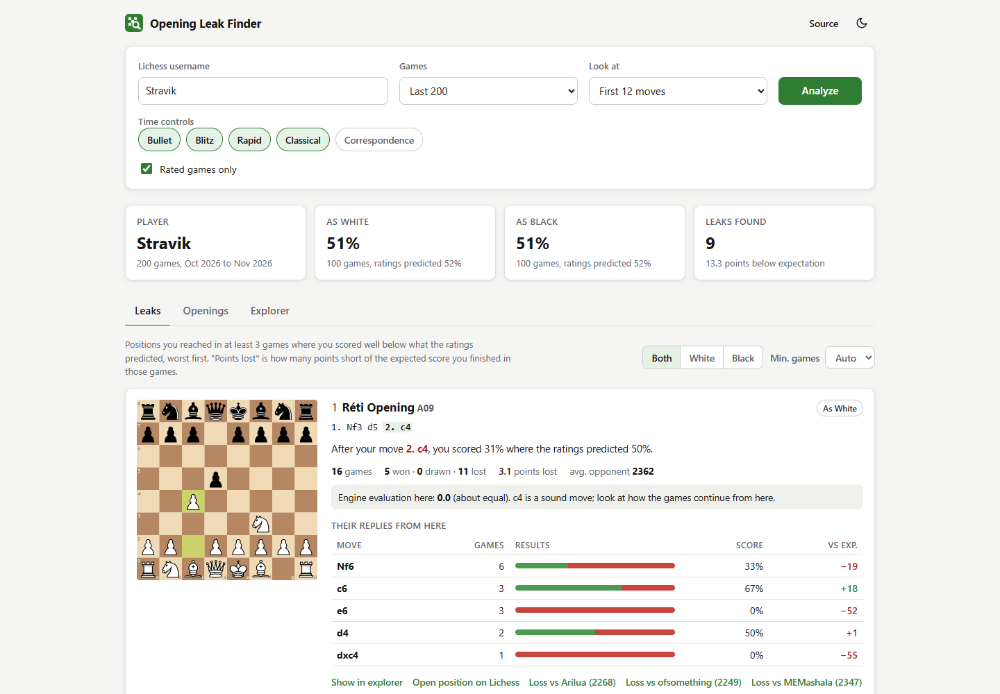

# Opening Leak Finder

Finds the opening lines that cost you the most points on Lichess.

**[Open Opening Leak Finder](https://stravix86.github.io/opening-leaks/)**



## What it does

Enter a Lichess username and it downloads your recent games, replays the first 8 to 16 moves of each one, and compares your results in every position with what the ratings predicted. A 50% score against much stronger opponents is fine, and a 50% score against much weaker opponents is a leak, so each game is weighed by the Elo expected score rather than by wins and losses alone.

- **Leaks:** the positions where you finish furthest below your expected score, worst first. Each one shows the board, the line, whether the damage comes from your move or from an opponent's reply, how you did with each continuation, and links to the games you lost from there.
- **Engine check:** when the position is in the Lichess cloud evaluation database, it shows the evaluation and whether your move was the engine's choice. That separates a bad move from a sound line you don't yet handle well.
- **Openings:** results by opening or variation for each colour, with score, expected score, net points and performance rating. Click any column to sort.
- **Explorer:** step through your own repertoire move by move, with results for every branch. "Show in explorer" on a leak jumps straight to that line.
- Filters for number of games (200 to 5,000), time controls, rated or casual, and how many moves deep to look.
- Links can be shared: `?user=Name` runs the analysis for that player when the page opens.

## How the leaks are chosen

1. Every position reached in the opening is collected, with transpositions merged, separately for White and Black.
2. For each position: points lost = (sum of expected scores) − (actual points), using the ratings at the time of each game.
3. Positions reached fewer than the minimum number of games are skipped (by default about 1% of the games, and at least 3), as are positions where the shortfall is spread thinly (under 12 percentage points per game).
4. Starting from the worst positions, it follows the line further while one continuation accounts for at least 70% of the loss, so each result points at the specific line that hurts rather than at a whole opening.

## Privacy

Games come straight from the public Lichess API into the page and are analysed in your browser. There is no server, no account and no tracking. The only thing stored is the last username you entered and your theme choice, in the browser's local storage.

## Running locally

Serve the folder with any static file server, for example:

```bash
python -m http.server 8000
```

Then open http://localhost:8000.

## Credits

- [chess.js](https://github.com/jhlywa/chess.js) (BSD 2-Clause) for move handling.
- Opening names from [lichess-org/chess-openings](https://github.com/lichess-org/chess-openings) (CC0).
- Piece images: the cburnett set by Colin M.L. Burnett (GPLv2+), as used on Lichess.
- Data from the [Lichess API](https://lichess.org/api). This project is not affiliated with Lichess.

## Licence

MIT for the code in this repository. See [LICENSE](LICENSE). Third-party files in `vendor/` keep their own licences.
